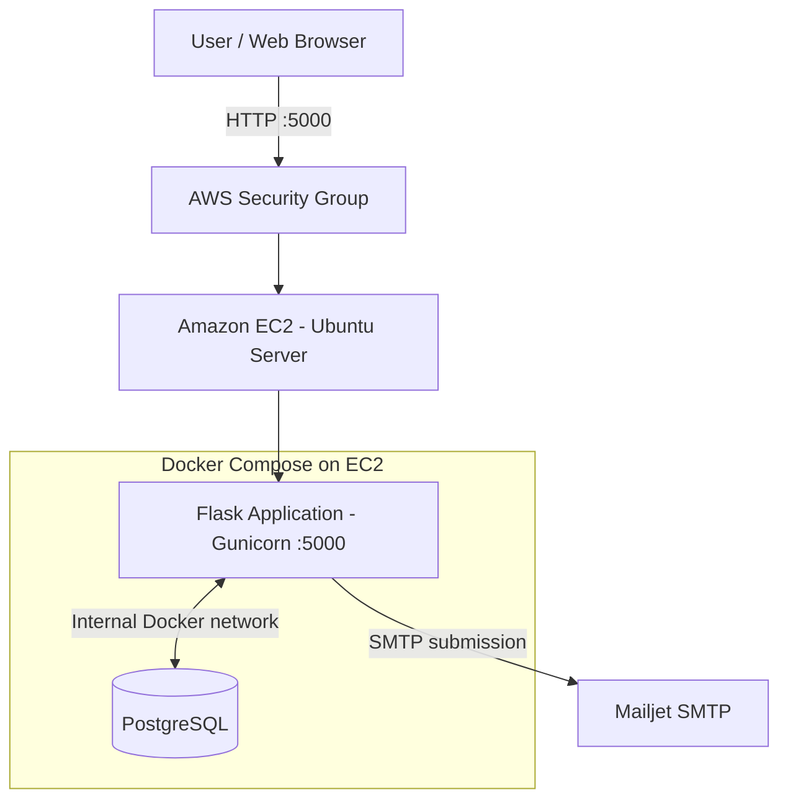
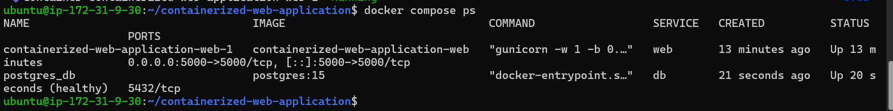

# Containerized Web Application Deployment on AWS

A containerized Flask web application deployed on **AWS EC2** using Docker Compose, Gunicorn, and PostgreSQL. This project demonstrates practical cloud deployment, Linux administration, container operations, network security, environment-based configuration, SMTP integration, troubleshooting, and deployment lifecycle management.

The AWS deployment was intentionally temporary: the application was deployed and functionally tested, screenshots were collected as evidence, and the EC2 resources were terminated to avoid ongoing infrastructure costs.

## Table of Contents

- [Project Overview](#project-overview)

- [Technical Highlights](#technical-highlights)

- [Technology Stack](#technology-stack)

- [Architecture](#architecture)

- [AWS Deployment](#aws-deployment)

- [Application Features](#application-features)

- [Deployment and Verification](#deployment-and-verification)

- [Security Considerations](#security-considerations)

- [Deployment Evidence](#deployment-evidence)

- [Troubleshooting](#troubleshooting)

- [Local Setup](#local-setup)

- [Cleanup and Cost Management](#cleanup-and-cost-management)

- [Key Learnings](#key-learnings)

- [Future Improvements](#future-improvements)

---

## Project Overview

This project focuses on deploying and operating a stateful web application using containerization and cloud infrastructure.

The application is built with Flask and uses PostgreSQL for persistent data storage. Docker packages the application and its runtime dependencies, Docker Compose coordinates the application and database containers, and Gunicorn serves the Flask application.

The primary deployment was performed on an Ubuntu-based Amazon EC2 instance in the AWS Mumbai Region (`ap-south-1`). Mailjet SMTP was configured to support password-reset emails. The deployment was tested through the public application endpoint, including authentication, blog operations, and the password-reset workflow.

The application was subsequently taken down, and the temporary AWS resources were cleaned up. Screenshots are retained as evidence of the deployment and functional tests.

## Technical Highlights

- **AWS infrastructure:** Deployed a containerized application on an Ubuntu EC2 instance in `ap-south-1`.

- **Linux administration:** Installed and configured Docker on the EC2 host and managed application deployment from the command line.

- **Container orchestration:** Used Docker Compose to build, start, inspect, and troubleshoot the application and PostgreSQL services.

- **Application runtime:** Served Flask through Gunicorn.

- **Database connectivity:** Configured PostgreSQL as a separate container on the internal Docker network.

- **Network security:** Removed the public PostgreSQL port mapping and restricted SSH access through the EC2 security group.

- **Configuration management:** Used environment variables for database credentials, Flask configuration, and SMTP settings.

- **Email integration:** Configured Mailjet SMTP and validated the password-reset email workflow.

- **Operational verification:** Inspected container status, database health, application logs, and application functionality.

- **Cost-conscious operations:** Terminated temporary EC2 infrastructure and checked for leftover deployment resources.

## Technology Stack

| Category | Technologies |
|---|---|
| Cloud platform | AWS EC2 |
| Operating system | Ubuntu Server 24.04 LTS |
| Containers | Docker, Docker Compose |
| Application framework | Python, Flask |
| Production application server | Gunicorn |
| Database | PostgreSQL, SQLAlchemy |
| Email service | Mailjet SMTP |
| CI/CD | GitHub Actions — existing workflow associated with the Render deployment |
| Source control | Git, GitHub |

## Architecture

The AWS deployment used a single EC2 instance to host the application and database containers. The application was exposed through TCP port `5000`, while PostgreSQL was accessible to the application through the internal Docker network.



**Architecture notes**

- EC2 provided the compute environment for the deployment.

- Docker Compose managed the application and database containers.

- Gunicorn served the Flask application.

- PostgreSQL was not published on a host port; the application accessed it over the internal Docker network.

- Mailjet SMTP handled password-reset email delivery.

- The application was accessed through the EC2 public IP during testing.

\> **Deployment status:** This diagram represents the temporary deployment that was tested. The EC2 instance has since been terminated; the application is not currently available at the historical public IP.

## AWS Deployment

### Infrastructure configuration

| Component | Configuration |
|---|---|
| Compute | Amazon EC2 |
| Region | Mumbai (`ap-south-1`) |
| Operating system | Ubuntu Server 24.04.5 LTS |
| Instance type | `t3.micro` |
| Container runtime | Docker |
| Orchestration | Docker Compose |
| Application port | TCP `5000` |
| Database port | Internal container port `5432` |
| Deployment lifecycle | Temporary deployment, validated, then terminated |

### Deployment workflow

1. Prepared the application and environment configuration locally.

2. Validated Mailjet SMTP configuration and tested password recovery locally.

3. Launched an Ubuntu EC2 instance and connected through SSH.

4. Installed Docker and the Docker Compose plugin.

5. Transferred the application files to the EC2 instance.

6. Protected the environment file with restricted file permissions.

7. Validated the Compose configuration and built the application image.

8. Started the application and database containers.

9. Inspected container status and database health.

10. Removed the PostgreSQL host-port mapping to prevent direct public database access.

11. Tested application functionality and password-reset email delivery.

12. Captured screenshots and terminated the temporary infrastructure.

### Container configuration

The deployment used a Compose configuration with two principal services:

- **Web:** Builds the Flask application image and publishes port `5000`.

- **Database:** Runs PostgreSQL with a persistent Docker volume and a health check.

The database credentials and connection URI were configured through environment variables. The database was not exposed through an EC2 host-port mapping.

## Application Features

- User registration and authentication

- Login and session management

- Blog post creation, editing, viewing, and deletion

- Account and profile management

- Profile image upload functionality

- Password recovery through email

- PostgreSQL-backed application data

- Environment-based runtime configuration

- Application logging and runtime diagnostics

## Deployment and Verification

The AWS deployment was verified through container-level checks and browser-based functional tests.

### Container operations

The following commands were used on the Ubuntu EC2 host:

```bash

# Install Docker and the Compose plugin

sudo apt update

sudo apt install -y docker.io docker-compose-v2

# Enable Docker

sudo systemctl enable --now docker

# Allow the Ubuntu user to use Docker

sudo usermod -aG docker ubuntu

newgrp docker

# Verify installations

docker --version

docker compose version

```

### Build and start the application

```bash

cd ~/containerized-web-application

# Validate Compose configuration without displaying its resolved values

docker compose config -q

# Build the application image and start the services

docker compose up --build -d

# Inspect container status and health

docker compose ps

```

### Troubleshooting

```bash

# Inspect application logs

docker compose logs --tail=40 web

# Inspect database logs

docker compose logs --tail=40 db

```

These commands helped validate the deployment and inspect runtime failures without relying solely on the browser.

### Functional validation

The following workflows were tested on the temporary EC2-hosted application:

- Opened the application through the EC2 public endpoint.

- Registered a test account and logged in.

- Created, viewed, updated, and deleted a blog post.

- Requested a password-reset email.

- Verified delivery through Mailjet SMTP.

- Opened the reset link, updated the password, and verified successful login.

The password-reset email was delivered during testing, although Gmail classified it as Spam. The reset email evidence must have its token and complete reset URL redacted before publication.

## Security Considerations

- **Secrets management:** Application credentials, database passwords, Flask secrets, and SMTP credentials were supplied through environment variables.

- **Environment file permissions:** The EC2 `.env` file was restricted using `chmod 600 .env`.

- **Database exposure:** PostgreSQL's host-port mapping was removed; the database remained accessible through the internal Compose network.

- **SSH access:** SSH access was restricted through the EC2 security group to a specific source IP range during the deployment.

- **Public application access:** TCP port `5000` was temporarily exposed to enable browser-based verification.

- **Source control hygiene:** Secret files and private keys must be excluded from Git version control.

- **Transport security limitation:** The temporary deployment was accessed over HTTP, not HTTPS. This was a demonstration environment, not a hardened production service.

For production use, the deployment should use HTTPS, a domain and reverse proxy or load balancer, stricter network rules, managed secrets, and an appropriate logging and monitoring strategy.

## Deployment Evidence

The AWS deployment was temporary, so this repository uses screenshots as evidence rather than claiming that a live AWS endpoint is still available. The files below are stored directly in the repository's `screenshots/` directory.

| Screenshot | What it demonstrates |
|---|---|
| [ec2-instance-running.png](screenshots/ec2-instance-running.png) | EC2 instance during deployment |
| [ec2-security-group.png](screenshots/ec2-security-group.png) | SSH and application ingress configuration |
| [docker-containers.png](screenshots/docker-containers.png) | Application container running and database healthy |
| [docker-versions.png](screenshots/docker-versions.png) | Docker and Compose installed on Ubuntu |
| [homepage.png](screenshots/homepage.png) | Application homepage |
| [login-page.png](screenshots/login-page.png) | Application login page |
| [registration-page.png](screenshots/registration-page.png) | Application registration page |
| [account-page.png](screenshots/account-page.png) | Authenticated account page |
| [post-details.png](screenshots/post-details.png) | Blog post functionality |
| [password-reset.png](screenshots/password-reset.png) | Password-reset form |
| [password-reset-success.png](screenshots/password-reset-success.png) | Successful password reset and login |
| [password-reset-email.png](screenshots/password-reset-email.png) | SMTP delivery evidence; publish only after the reset token and complete URL are redacted |

### Example screenshot



Do not commit unredacted reset links, tokens, credentials, private keys, or screenshots containing sensitive AWS account information.

## Troubleshooting

| Issue | Diagnostic approach |
|---|---|
| Container fails to start | Inspect `docker compose ps` and the relevant service logs |
| Compose configuration fails | Run `docker compose config -q`; check required environment variables |
| Database connection fails | Verify the database service name, credentials, connection URI, and health status |
| Application is unreachable | Verify the container status, port mapping, EC2 security group, and public IP |
| Password-reset email is not received | Verify Mailjet SMTP configuration, sender verification, application logs, and the spam folder |
| Docker permission error | Verify group membership and reconnect to the SSH session if needed |

## Local Setup

### Prerequisites

- Git

- Docker Engine

- Docker Compose plugin

### Clone the repository

```bash

git clone https://github.com/Onkar-M-Dev/containerized-web-application.git

cd containerized-web-application

```

### Configure environment variables

Create the environment files from the repository's sample templates:

```bash

cp .env-sample .env

cp .env.sample-db .env.db

```

Populate the required values using the templates and the application's configuration. Do not reuse production credentials or commit real `.env` files.

### Build and run

```bash

docker compose up --build -d

docker compose ps

```

Open the application at:

`http://localhost:5000`

Stop the local services when finished:

```bash

docker compose down

```

The named PostgreSQL volume is retained by this command. To delete local database data as well, use `docker compose down -v` only when you are certain that the data is no longer needed.

## Cleanup and Cost Management

The AWS deployment was temporary and has been terminated after functional testing.

The cleanup checks confirmed by the user were:

- EC2 instance terminated.

- No leftover EBS volumes from this deployment.

- No unused Elastic IPs allocated for this deployment.

- No snapshots or other billable resources from this deployment identified.

For future temporary deployments, collect evidence before termination, then inspect EC2 instances, EBS volumes, Elastic IPs, snapshots, and any additional services created for the project. Review AWS Billing after usage data has updated; terminating an instance does not guarantee that every possible charge is zero.

## Key Learnings

- Deploying a containerized application on a Linux-based EC2 instance.

- Installing and operating Docker and Docker Compose.

- Managing a multi-container application with PostgreSQL.

- Configuring production application runtime settings and environment variables.

- Restricting database network exposure.

- Troubleshooting container startup, connectivity, and runtime issues.

- Integrating SMTP-based password recovery.

- Validating an application through end-to-end tests.

- Capturing deployment evidence and cleaning up temporary cloud infrastructure.

## Future Improvements

- Automate AWS deployment through a dedicated GitHub Actions workflow.

- Provision EC2 and supporting infrastructure using Terraform.

- Add HTTPS using a domain and reverse proxy or an AWS-managed entry point.

- Introduce centralized logging, metrics, alarms, and operational dashboards.

- Evaluate Amazon RDS for managed PostgreSQL.

- Add automated tests, dependency scanning, and container image security checks.

- Improve deployment repeatability through infrastructure-as-code and documented recovery procedures.

## Author

**Onkar Marne**

- GitHub: [Onkar-M-Dev](https://github.com/Onkar-M-Dev)

- LinkedIn: [Onkar Marne](https://www.linkedin.com/in/onkar-m-54166819b)
